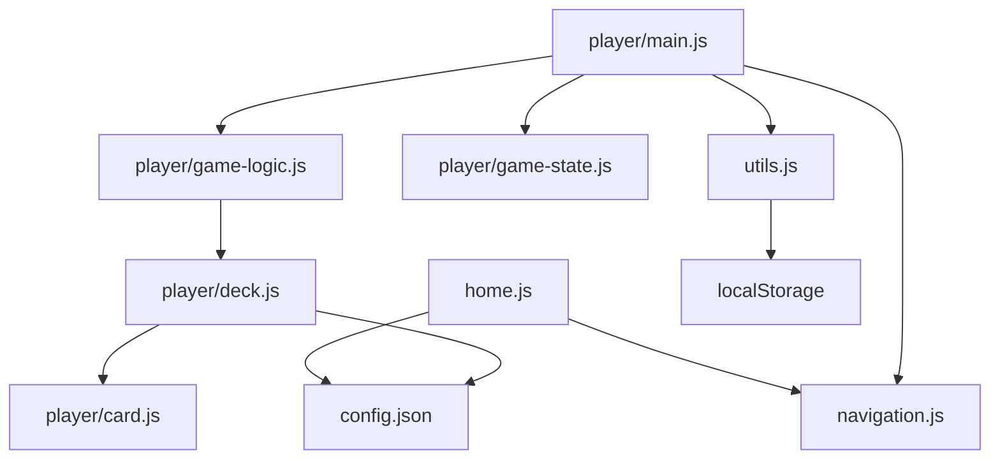
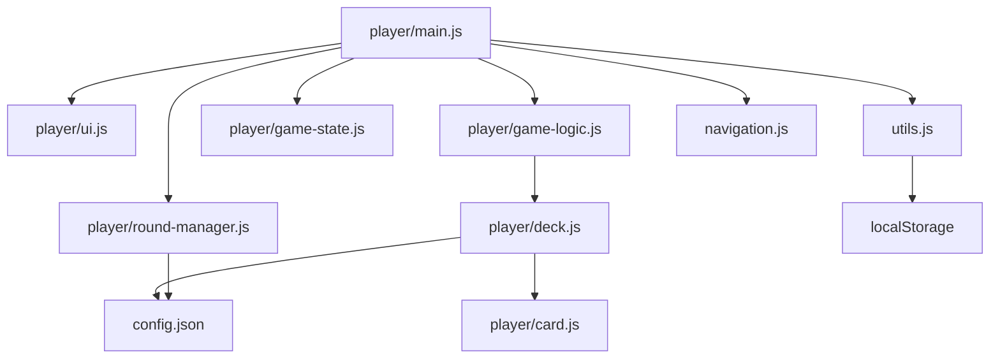

# Assignment 3 - Blackjack Refactor

## Task 1a - Current Architecture

The project started with these main JavaScript files:

- `scripts/home.js` - handles the home page and username entry
- `scripts/navigation.js` - handles page navigation buttons and keyboard shortcuts
- `scripts/utils.js` - reads the username from `localStorage`
- `scripts/player/card.js` - card object and card image rendering
- `scripts/player/deck.js` - deck creation, shuffle, and deal logic
- `scripts/player/game-logic.js` - blackjack rules and scoring
- `scripts/player/game-state.js` - shared state like bankroll, bet, wins, and losses
- `scripts/player/main.js` - player page logic
- `scripts/config.json` - game settings and card data

The main problem was `scripts/player/main.js`. It handled too many responsibilities in one file:

- DOM updates
- event listeners
- betting logic
- dealer turn flow
- payout/result updates

It also duplicated state by keeping local variables like `playerMoney` and `currentBet` separate from `gameState`.

### Before Diagram

## Task 1b - Proposed Modular Design

I split the player page into smaller modules with clearer roles.

### Modules

- `player/main.js`
  Entry point for the player page. It collects DOM elements and connects events to the other modules.

- `player/ui.js`
  Handles rendering and display updates.
  Exposes:
  `updateBettingDisplay`, `updateWinLossDisplay`, `setGameplayActive`, `setActionButtonsDisabled`, `updateButtons`, `showHands`

- `player/round-manager.js`
  Handles round flow and bet settlement.
  Exposes:
  `sleep`, `loadInitialBalance`, `setWaitingForBetState`, `finalizeRound`, `startRoundFromBet`, `runDealerTurn`

- `player/game-logic.js`
  Handles blackjack rules.
  Exposes:
  `Game`

- `player/deck.js`
  Handles deck creation and dealing.
  Exposes:
  `Deck`

- `player/card.js`
  Handles card data and rendering.
  Exposes:
  `Card`

### Refactor Goals

- make `gameState` the single source of truth
- separate rendering from game flow
- reduce the size and responsibility of `main.js`
- keep imports/exports clean with ES6 modules

### After Diagram

## Task 2 - Refactors Implemented

### Refactor 1 - UI Module

I created `scripts/player/ui.js` and moved these responsibilities out of `main.js`:

- betting display updates
- win/loss display updates
- recent result history rendering
- enabling/disabling gameplay controls
- rendering player and dealer hands

### Refactor 2 - Round Manager Module

I created `scripts/player/round-manager.js` and moved these responsibilities out of `main.js`:

- loading the starting bankroll
- resetting the round
- starting a round from a bet
- dealer turn timing and flow
- final payout and result updates

### Result

After the refactor, `main.js` mainly coordinates events while the new modules handle rendering and round flow. The game behavior stays the same, but the code is easier to read and extend.

## Extra Credit - JSDoc

JSDoc comments were added to exported functions in:

- `scripts/player/ui.js`
- `scripts/player/round-manager.js`
